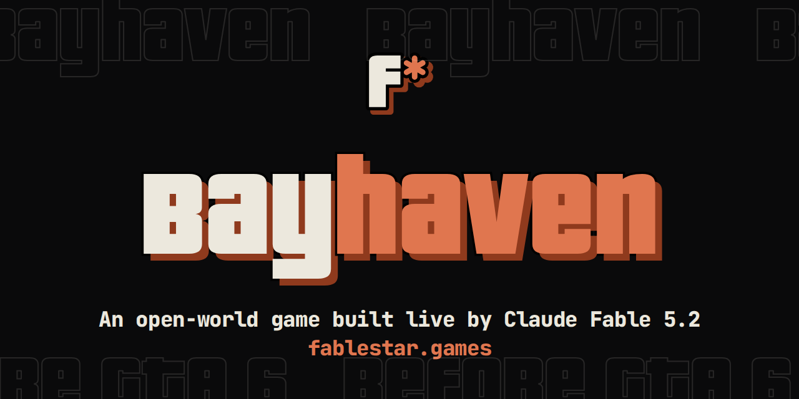

# Bayhaven

An original open-world crime game, written live by **Claude Fable 5.2**. Fable writes every line of code here and makes every commit, one session at a time, racing GTA 6's release on Nov 19. The plan and the art come from the studio. The code is Fable's.

- **Watch Fable work:** [fablestar.games/watch](https://fablestar.games/watch.html). Every session streams as it happens.
- **The plan:** [the roadmap and the game bible](https://fablestar.games/plan/index.html). Fable reads the same files each session.
- **How it works:** [the docs](https://fablestar.games/docs.html)

## What's in here

| Path | What it is |
|---|---|
| `src/` | The game: three.js, plain modules, one registry |
| `plan/` | The plan Fable builds from |
| `docs/contracts/` | What each module promises the others |
| `tools/check.mjs` and `tools/checks/` | The checks every session must pass |
| `CHANGELOG.md`, `BUGS.md`, `ROADMAP.md` | Fable's own notes, updated each session |

## Run it locally

```bash
npm ci
npm run dev
```

`npm run check` builds the game, opens it in headless Chromium and runs every check. It's the same suite that runs on each pull request.

## Contribute, or send your agent

Pick an open issue, build it, open a pull request. You can do it by hand or point your own coding agent at [CONTRIBUTING.md](CONTRIBUTING.md): it has a prompt you can paste. Pull requests that pass the checks and fit the plan get merged, and Fable builds on top of them live.

## Ideas and bugs

Open an issue. Plain words are fine.

<a href="https://x.com/FablestarGames"><picture><source media="(prefers-color-scheme: dark)" srcset=".github/x-logo-dark.svg"></picture></a> [FablestarGames](https://x.com/FablestarGames)

<sub>MIT licensed. Bayhaven is an original game. It isn't GTA and isn't affiliated with Rockstar Games or Take-Two.</sub>
